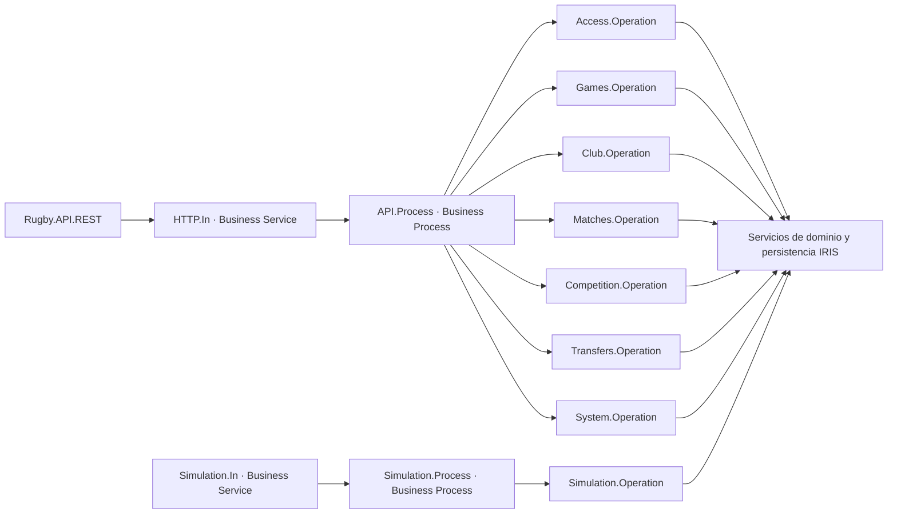

# Backend sobre interoperabilidad de IRIS

## Entrada y producción

La entrada HTTP sigue siendo **`Rugby.API.REST`**. Conserva las rutas, las respuestas JSON y las cookies de acceso existentes. La propia clase llama a `Ens.Director.CreateBusinessService("HTTP.In",.service)` y a `service.ProcessInput(request,.response)`.

La producción **`Rugby.Interop.Production`**, en el namespace **RUGBY**, coordina todas las peticiones del backend:



Los Business Operations son clases independientes que heredan la ejecución común de `Rugby.Interop.Operation.Execute`. Los servicios de dominio conservan las reglas deportivas, validaciones, transacciones, bloqueo de escritura, control de versiones e idempotencia. El enrutamiento antes incluido en la API se encuentra en `Rugby.Service.Router`, invocado desde los Business Operations.

`System.In` inicia la preparación idempotente de datos a través de la producción. El arranque detiene solamente la producción de Rugby, habilita el namespace, compila las clases y la inicia de nuevo. No borra cuentas, partidas ni mensajes por el hecho de reiniciar.

## Simulación automática

El antiguo bucle `JOB Rugby.Job.Worker.Run` se sustituye por **Simulation.In**, con `Ens.InboundAdapter` y sondeo de 0,25 segundos. Por cada encuentro activo envía una petición con partida, partido y tiempo transcurrido a Simulation.Process → Simulation.Operation. El sondeo sin encuentros activos solo actualiza el indicador operativo de salud, sin generar mensajes vacíos.

La operación comprueba de nuevo el estado de la partida bajo bloqueo, aplica el ciclo transaccional y devuelve reloj, marcador, versiones y rango de eventos generado. Los eventos nuevos y los ingresos de liquidación se incluyen en `DetailsJSON` de la respuesta persistida. No se recupera tiempo de simulación por periodos en los que IRIS estuvo detenido.

## Auditoría nativa

No se añade ninguna pantalla de auditoría al juego, ni tablas o endpoints propios de auditoría. Se utilizan los **mensajes y cabeceras de interoperabilidad**, el **Visor de mensajes**, la **Traza visual** y el **Registro de eventos** de IRIS.

Cada petición se representa mediante `Rugby.Interop.Message.Request` y `Rugby.Interop.Message.Response`. Se conservan ruta, identificador de correlación, partida, clave de reintento, consulta, cuerpo permitido, respuesta, usuario, duración y estado HTTP. La respuesta de avanzar día incluye en `DetailsJSON` la ejecución de entrenamiento y los movimientos económicos de esa fecha. Las respuestas de simulación incluyen sus eventos y liquidación.

La API devuelve:

- `X-Request-Id`: correlación de la petición, también presente en los errores JSON.
- `X-Interop-Session-Id`: sesión nativa para localizar la traza completa.

Las validaciones y errores de negocio devuelven su estado HTTP habitual y generan advertencias; los errores de servidor generan eventos de error. Una validación rechazada sigue siendo una respuesta controlada del proceso: revisar `HTTPStatus` y `ErrorCode` en el cuerpo, además del registro de eventos. Los reintentos crean su propia traza, conservando la clave de idempotencia y sin repetir los efectos ya confirmados.

Los componentes síncronos utilizan **InProc**, de modo que el contexto CSP y las credenciales originales solo permanecen en memoria durante la petición. Las contraseñas, tokens, cookies y secretos se excluyen o enmascaran antes de persistir el mensaje. No se copian cabeceras Authorization o Set-Cookie a los cuerpos de interoperabilidad. Los canales internos de inicialización y simulación no pueden activarse mediante una ruta HTTP ni mediante campos del JSON del cliente.

Si la producción no está disponible, la API devuelve **503 INTEROP_UNAVAILABLE** y no ejecuta la lógica de dominio directamente. El diagnóstico de indisponibilidad conserva el identificador de petición en el registro técnico existente. Las peticiones que no pudieron entrar en una producción detenida no tienen sesión de interoperabilidad.

## Consulta en IRIS

El [Portal de administración de IRIS](http://localhost:8085/csp/sys/UtilHome.csp) se publica únicamente en localhost. Usa las credenciales del servidor IRIS, no la cuenta del juego.

1. Seleccionar el namespace **RUGBY**.
2. Abrir **Interoperabilidad → Configurar → Producción** para consultar `Rugby.Interop.Production`.
3. En **Ver → Mensajes**, buscar la sesión indicada por `X-Interop-Session-Id` y abrir la **Traza visual**.
4. Consultar el **Registro de eventos** para advertencias, errores y arranques/paradas.

Las peticiones HTTP se reintentan desde el cliente, con su sesión JWT y su clave de idempotencia; los mensajes auditados no contienen las credenciales necesarias para reproducir un login desde el visor.

La conservación y purga de mensajes se administra con las herramientas estándar de IRIS. No se programa una política de borrado adicional desde el juego.

También se puede consultar la traza con SQL en RUGBY:

```sql
SELECT ID, SessionId, SourceConfigName, TargetConfigName,
       MessageBodyClassName, MessageBodyId, TimeCreated
FROM Ens.MessageHeader
WHERE SessionId = :sessionId
ORDER BY ID
```

## Verificación

- Suite de dominio y producción: `iris/test.script`.
- HTTP sobre una instancia desechable: `RUGBY_API_BASE=http://localhost:52776/api/v1` y `RUGBY_REQUIRE_INTEROP=1`, ejecutando `scripts/session_integration.py`.
- Comprobaciones adicionales: `scripts/interop_integration.py`, restringido al contenedor desechable `rugby-interop-check`.

Las pruebas comprueban sesiones y cabeceras nativas, servicios/procesos/operaciones, registro y login, partidas, entrenamientos, staff, amistosos, simulación, conflictos, aislamiento de usuarios, ausencia de credenciales en los mensajes y conservación de datos al detener y reanudar la producción.

El patrón de entrada corresponde a la [documentación de servicios REST en producciones](https://docs.intersystems.com/irislatest/csp/docbook/DocBook.UI.Page.cls?KEY=EREST_business_service) de InterSystems.


## Avance diario y rivales

Las peticiones de avanzar día se derivan desde API.Process a Rivals.Process → Rivals.Operation antes de abrir la transacción. Una sola operación confirma el avance del club propio y de los diecinueve rivales. Su respuesta persistida incluye el informe completo en `DetailsJSON.rivalsExecution`. Ver [políticas de gestión automática](RIVALES.md). Los mensajes no se envían entre hosts mientras está abierta la transacción de dominio del día.

Las operaciones de mercado y negociación pasan por `Transfers.Operation`. La firma registra el contrato y los movimientos económicos en `DetailsJSON`; el umbral salarial privado no se devuelve en las respuestas públicas. Ver [fichajes](FICHAJES.md).
