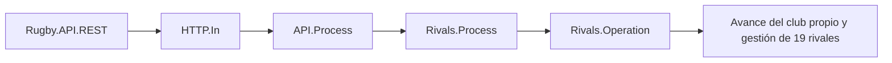

# Gestión automática de los clubes rivales

Los diecinueve clubes que no dirige el usuario se gestionan al avanzar cada día de la partida. La fecha no progresa por tiempo real y una partida pausada no acumula entrenamientos. El equipo del usuario conserva su planificación, jugadores, técnicos y decisiones.

## Decisiones reproducibles

La partida guarda una semilla derivada de sus sorteos de liga. La gestión utiliza esa semilla y los identificadores, la fecha y el estado de los jugadores; no usa aleatoriedad sin guardar ni la hora del ordenador. Un mismo estado y semilla produce las mismas decisiones, incluidas prioridades de acceso al mercado. Los sorteos de temporadas posteriores también derivan de la semilla guardada.

`RivalExecution`, con una clave por día y partida, conserva el resultado. Reintentar un avance confirmado no repite el entrenamiento, las nóminas, los fichajes o los efectos de un partido.

## Entrenamiento y cantera

Cada jugador pertenece a un grupo diario. Se elige entre las diecisiete características, priorizando carencias y posición: fuerza y formaciones para delanteros; velocidad, agilidad, pase y manejo para tres cuartos. Parte de las sesiones corrige carencias generales para repartir la mejora y evitar entrenar siempre una característica ya alta.

Se aplica el mismo desarrollo por edad y calidad de entrenadores que al equipo del usuario. No hay mejoras gratuitas de atributos: cada sesión mejora exclusivamente la característica asignada. Los veteranos conservan el declive previsto por el modelo.

Se programa recuperación en fines de semana, con energía inferior a 65 o indisponibilidad. El primer equipo descansa también el día anterior y el propio día de un partido. La cantera mantiene su programa cuando solo juega el primer equipo. Las sesiones son normales o, con energía suficiente, intensas; ambos grupos acumulan cansancio real y recuperan energía en sus descansos.

La cantera mantiene al menos veinte jugadores y cobertura de las quince posiciones. Las promociones aplican el salario sénior correspondiente y se cubren las vacantes con nuevos juveniles de 16–20 años, atributos variados y salarios reducidos. A partir de los 23 años se evalúa el paso al primer equipo; si no hay encaje, el jugador queda libre conservando su historial. Se reponen esas plazas para mantener una cantera joven.

## Técnicos y jugadores

Hay una revisión inicial y revisiones escalonadas cada 28 días por club. Se favorece mejorar los puestos técnicos más débiles, con prioridad para cantera y preparación física. Se contrata como máximo un técnico por revisión, buscando mejoras de 2–8 puntos y salarios acordes a su calidad, con una reserva económica. Se utiliza el mercado disponible y, cuando no tiene un candidato adecuado, se genera uno determinista. El técnico sustituido vuelve al mercado. No se contratan técnicos que ya pertenezcan a un club.

Los refuerzos priorizan la posición de un jugador sénior débil, valorando calidad, edad, salario y presupuesto. Primero se considera la cantera. Los fichajes externos se realizan entre agentes libres, incluidos descartes de clubes y un mercado compartido de hasta veinte candidatos disponibles. Su prima de incorporación y salario se registran; los agentes generados no proceden del club del usuario. No se implementan negociaciones de traspasos entre clubes con contrato vigente.

Se limitan las incorporaciones a dos fichajes y dos promociones por temporada y a una decisión por revisión. Cuando sobran jugadores se consideran salidas de jugadores no convocados, conservando profundidad y especialistas de primera línea. La plantilla admite un máximo de 28 séniores, ampliable a 30 para cubrir lesiones. Se revisan bajas por lesión diariamente, con hasta seis recambios médicos por temporada adicionales a los dos fichajes ordinarios. No se libera a un lesionado ni a su recambio mientras siga siendo necesario. Las propuestas compiten por salario mensual y después por clasificación; los rivales que pierden un candidato prueban alternativas. La contratación respeta el saldo y la reserva médica limitada del presupuesto. El objetivo es una renovación gradual, no sustituir todo el equipo de una vez. La gestión no rescinde ni vende jugadores del usuario.

## Alineaciones, partidos y economía

Cada rival elige el XV y el banquillo por posición natural, calidad, disponibilidad y energía, sin duplicados y con especialistas de primera línea. La alineación queda validada por las mismas reglas del juego.

La energía influye en la fuerza de los partidos agregados entre rivales. Sus titulares pierden entre 21 y 29 puntos de energía y sus reservas 3; el efecto solo se aplica una vez por encuentro. Cuando un rival juega contra el usuario, se conservan las energías reales del motor del partido para ambos equipos.

Se contabilizan nóminas mensuales de jugadores y empleados, primas y los ingresos reales de partidos. El entrenamiento queda cubierto por el salario de los técnicos. La taquilla local depende de asistencia y precio; en amistosos se reparte al 50 %. El bar pertenece a la concesión financiera anual. Los fichajes se supeditan al presupuesto y a la tesorería disponible.

## Interoperabilidad y transacciones

El avance sigue el flujo:

El proceso se selecciona antes de abrir la transacción. **Un único Business Operation confirma el día completo**, incluidos entrenamientos, mercado, salarios y partidos agregados. Si falla un rival, se revierte todo el avance. Esto evita que un envío de mensajes dentro de una transacción abierta provoque confirmaciones parciales del motor.

La auditoría continúa siendo la nativa de IRIS. `DetailsJSON` incluye la ejecución del equipo gestionado y `rivalsExecution`: decisiones, grupos, resultados individuales, técnicos, alineaciones, salidas, incorporaciones y movimientos económicos. No se añade una pantalla de auditoría.

## Partidas existentes

La adopción al instalar esta versión alinea las fechas de los rivales con la del usuario, prepara sus planes y el mercado, y conserva sus atributos y energía. No se conceden entrenamientos ni se cargan nóminas de los días históricos. El siguiente avance aplica la primera jornada automática. No se modifica la plantilla, el saldo ni el plan del club del usuario durante la adopción.

Las búsquedas de datos por club y partido utilizan índices auxiliares por partida, construidos de forma compatible con los datos existentes. Así se evita recorrer todas las plantillas para procesar cada club.
